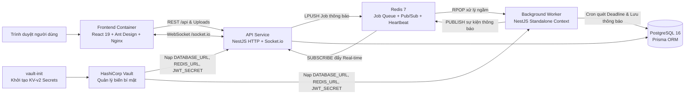

# TaskMaster — Hệ thống Quản lý Công việc & Dự án

Nền tảng quản lý dự án và công việc theo mô hình bảng Kanban / Bảng danh sách thời gian thực, tách dịch vụ theo hướng Microservice (API Service, Background Worker, Redis Event Bus & Job Queue, HashiCorp Vault Secret Management).

---

## 1. Kiến trúc hệ thống



### Các thành phần chính
- **Frontend (`taskmaster_frontend`):** React 19, Vite, TypeScript, Ant Design, Zustand, `@hello-pangea/dnd`, phục vụ qua Nginx reverse proxy (`/api`, `/socket.io`, `/uploads`).
- **API Service (`taskmaster_backend`):** NestJS xử lý nghiệp vụ RESTful API, xác thực JWT, phân quyền theo dự án (`OWNER`, `ADMIN`, `MEMBER`, `VIEWER`), tài liệu Swagger và cổng kết nối WebSocket (`Socket.io`).
- **Background Worker (`taskmaster_worker`):** Tiến trình NestJS độc lập không mở cổng HTTP, chuyên chạy Cron Job quét công việc sắp đến hạn / quá hạn mỗi giờ và tiêu thụ hàng đợi công việc bất đồng bộ từ Redis.
- **Redis (`taskmaster_redis`):** Đóng vai trò hàng đợi tác vụ (`taskmaster:queue:notifications`), kênh truyền sự kiện thời gian thực (`taskmaster:pubsub:notifications`) từ Worker sang API để bắn chuông thông báo tức thì, kèm khóa nhịp tim (`taskmaster:worker:heartbeat`).
- **HashiCorp Vault (`taskmaster_vault` + `taskmaster_vault_init`):** Lưu trữ tập trung toàn bộ cấu hình nhạy cảm (`DATABASE_URL`, `REDIS_URL`, `JWT_SECRET`, `PORT`) trên KV-v2 engine. Cả bước chạy `prisma migrate deploy`, API và Worker đều nạp secret trực tiếp từ Vault lúc khởi động (tự động fallback về `.env` khi phát triển cục bộ không bật Vault).
- **PostgreSQL (`taskmaster_postgres`):** Cơ sở dữ liệu quan hệ quản lý người dùng, dự án, thành viên, cột Kanban, công việc, checklist, bình luận, tệp đính kèm, thông báo và nhật ký hoạt động (Activity Audit Log).

---

## 2. Chức năng nổi bật

- **Không gian dự án & Phân quyền:** Tạo dự án theo mã định danh (`KEY-1`, `KEY-2`), mời thành viên qua email, phân quyền chi tiết `OWNER`, `ADMIN`, `MEMBER`, `VIEWER`.
- **Bảng Kanban & Chế độ Bảng (Table View):** Kéo thả đổi cột trạng thái và vị trí công việc mượt mà, tùy biến màu sắc cột, lọc nhanh theo từ khóa, mức độ ưu tiên và công việc cá nhân.
- **Chi tiết công việc & Cộng tác:** Checklist công việc con có thanh tiến độ, bình luận trực tiếp, tải lên / xem trước tệp đính kèm, ghi vết lịch sử thao tác tự động (`ActivityLog`).
- **Thông báo Real-time & Nhắc hạn tự động:** Chuông thông báo nảy số tức thời qua `Socket.io` + `Redis Pub/Sub` khi được giao việc, mời vào dự án, có bình luận mới hoặc công việc sắp đến hạn / quá hạn.
- **Dashboard & Tiện ích:** Thống kê tổng quan tiến độ, bảng ghi chú nhanh (Sticky Notes), tìm kiếm toàn cục (`Ctrl + K`), giao diện Sáng / Tối (Dark Mode) và tương thích thiết bị di động.

---

## 3. Chạy nhanh toàn bộ hệ thống bằng Docker Compose

Yêu cầu máy đã cài **Docker Desktop**:

```bash
docker compose up -d --build
```

Sau khi các container khởi động xong, có thể nạp dữ liệu mẫu để trải nghiệm ngay:

```bash
docker exec -it taskmaster_backend npm run seed
```

### Các đường dẫn truy cập
| Dịch vụ | Địa chỉ | Ghi chú |
| :--- | :--- | :--- |
| **Giao diện Web** | http://localhost (hoặc http://localhost:5173) | Nginx tự động proxy API & WebSocket |
| **Swagger API Docs** | http://localhost:3000/api/docs | Tài liệu và thử nghiệm trực tiếp REST API |
| **System Healthcheck** | http://localhost:3000/api/health | Kiểm tra trạng thái sống của API, DB, Vault, Redis, Worker |
| **HashiCorp Vault UI** | http://localhost:8200 | Đăng nhập bằng Token: `root` |

---

## 4. Chạy môi trường phát triển cục bộ (Local Development)

Hệ thống hỗ trợ cơ chế **tự động fallback**: khi chạy trên máy cá nhân không bật Vault hoặc Redis, ứng dụng tự đọc cấu hình từ `backend/.env` và xử lý trực tiếp trong tiến trình mà không báo lỗi.

### Bước 1: Khởi chạy Backend API & Worker
```bash
cd backend
npm install
npx prisma migrate dev
npm run seed

# Terminal 1: Chạy REST API + WebSocket (cổng 3000)
npm run start:dev

# Terminal 2 (tùy chọn): Chạy Background Worker riêng
npm run start:worker:dev
```

*(Nếu muốn nạp secret mẫu từ `backend/.env` lên Vault đang chạy ở cổng `8200`, chạy lệnh `npm run vault:init`).*

### Bước 2: Khởi chạy Frontend
```bash
cd frontend
npm install
npm run dev
```
Mở trình duyệt tại http://localhost:5173 (Vite đã cấu hình sẵn proxy `/api`, `/socket.io` và `/uploads` sang cổng `3000`).

---

## 5. Tài khoản trải nghiệm (sau khi chạy `seed`)

Mật khẩu chung cho tất cả tài khoản mẫu: `Password123@`

- **Quản trị viên:** `admin@taskmaster.vn`
- **Trưởng nhóm dự án:** `phuc.nv@taskmaster.vn`
- **Thành viên phát triển:** `hoang.nm@taskmaster.vn`
- **Kiểm thử viên (QA):** `linh.tt@taskmaster.vn`
